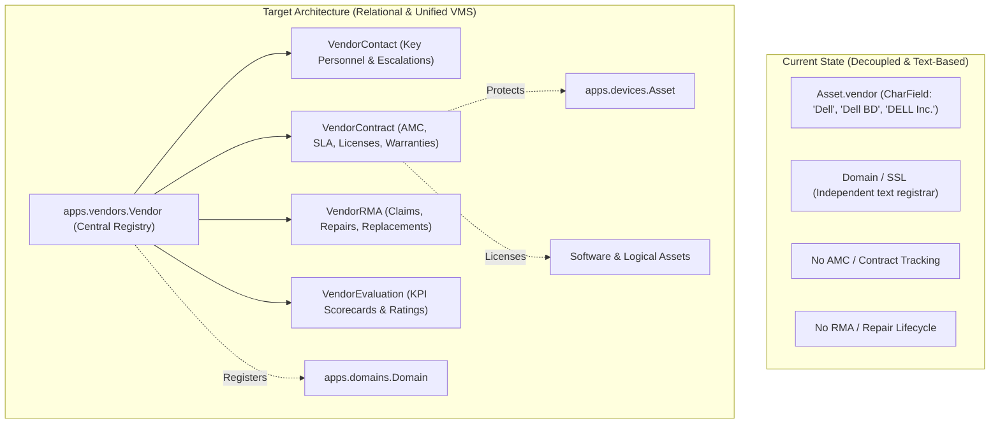
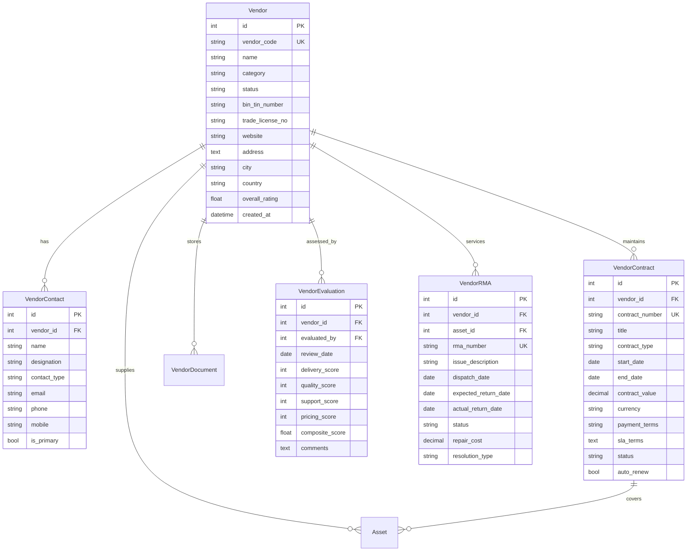
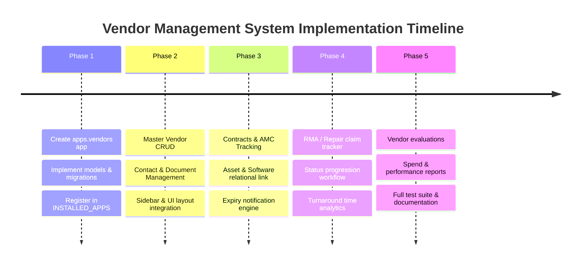

# Vendor Management System (VMS) - Architectural & Implementation Plan

> **Project:** IT Asset Audit & Inventory Management System  
> **Enterprise:** Akij Group  
> **Developer:** Ariba Soft  
> **Status:** Draft / Architectural Blueprint  
> **Target App:** `apps.vendors` (or integration within `apps.devices` & `core_project`)  
> **Related Documents:** [System Settings Plan](SYSTEM_SETTINGS_PLAN.md) | [Software Specification](docs/SOFTWARE_SPECIFICATION.md) | [Development Tasks](DEVELOPMENT_TASKS.md)

---

## 1. Executive Summary & Objective

In enterprise IT infrastructure across Akij Group's diversified business units, managing relationships with hardware OEMs, software publishers, cloud providers, ISPs, and Annual Maintenance Contract (AMC) service providers is mission-critical.

Currently, the asset audit system tracks vendor details through unstructured text fields (`vendor = models.CharField(...)` in `Asset`), leading to data redundancy, spelling inconsistencies, and lack of visibility into warranties, service contracts, and vendor performance.

The **Vendor Management System (VMS)** transforms this into a centralized, relational, and auditable enterprise module that:
1. Standardizes vendor registration, contact directories, and compliance verification.
2. Manages IT contracts, AMCs, SLAs, and warranty renewals with automated proactive alerts.
3. Maps every physical device, software license, and domain/SSL asset to a verified vendor entity.
4. Tracks Return Merchandise Authorizations (RMA), warranty claims, and repairs.
5. Provides vendor performance evaluations (scorecards) and procurement spend analytics.

---

## 2. Current State vs. Target Architecture



---

## 3. Core Feature Modules

### Module 1: Vendor Registry & Profile Management
- **Vendor Master Directory:** Categorization by vendor type (Hardware OEM, Authorized Distributor, Software Publisher, Cloud/SaaS Provider, Maintenance/Repair Contractor, ISP/Telecom, Consumable Supplier).
- **Corporate Details:** Trade license number, BIN/TIN, Tax status, Corporate address, Website, Global headquarters, Local distributor authorization.
- **Status Lifecycle:** `DRAFT` ➔ `ACTIVE` ➔ `PREFERRED` ➔ `UNDER_REVIEW` ➔ `BLACKLISTED` ➔ `INACTIVE`.
- **Contact Directory:** Multiple contact persons per vendor (Sales Manager, Technical Support Engineer, Escalation Officer, Account Billing) with direct phone, mobile, and email.
- **Document Repository:** Secure attachment of Vendor Trade License, VAT Registration, Authorized Dealership Certificate, and Tax Clearance Certificates (PDF/Images).

### Module 2: Contract, AMC & SLA Lifecycle Management
- **Contract Types:**
  - Annual Maintenance Contract (AMC) – Comprehensive & Non-Comprehensive.
  - Service Level Agreement (SLA) with defined response and resolution windows (e.g., 4-hour on-site response for servers).
  - Software License & Subscription Agreements (SaaS / Perpetual).
  - Master Services Agreement (MSA).
  - Extended Hardware Warranty.
- **Financial & Operational Terms:** Contract value, payment milestone schedule, currency (BDT, USD), billing frequency (Monthly, Quarterly, Annual).
- **Expiration & Renewal Engine:** 90, 60, 30, and 7-day proactive expiry alerts to IT Admins and Procurement leads before AMC or warranty lapses.
- **Contract Attachments:** Scanned signed contracts, renewal addendums, and purchase orders.

### Module 3: Asset & License Relational Mapping
- **Hardware Asset Linking:** Foreign key from `Asset` to `Vendor` (with seamless migration from existing `Asset.vendor` CharField without breaking existing records).
- **Software Publisher Integration:** Connect commercial software licenses to publisher profiles (e.g., Microsoft, Oracle, VMware, Adobe).
- **Domain & SSL Registrar Linking:** Map domain registrars (e.g., BTCL, GoDaddy, Namecheap) and SSL certificate issuers (e.g., DigiCert, Sectigo, Let's Encrypt) to vendor profiles.
- **Spend & Asset Density:** Instant dashboard view showing all active physical hardware, software licenses, and cloud resources sourced from a given vendor.

### Module 4: RMA, Warranty Claims & Repair Tracker
- **RMA Lifecycle Workflow:**
  `LOGGED` ➔ `DISPATCHED_TO_VENDOR` ➔ `UNDER_DIAGNOSIS` ➔ `REPAIRED` / `REPLACED` ➔ `RETURNED_TO_PREMISES` ➔ `CLOSED`.
- **Claim Attributes:** Fault description, Serial number, RMA tracking number, Courier/Challan dispatch reference, Standby/Loaner unit provided (Yes/No), Estimated delivery date.
- **SLA Breach Monitoring:** Flagging claims that exceed agreed vendor repair turn-around time (TAT).
- **Cost Tracking:** Out-of-warranty repair cost, spare parts replaced, warranty status validation.

### Module 5: Vendor Performance Evaluation & Scorecards
- **Evaluation Criteria (Weighted Scoring 1-5 Stars / 100% Scale):**
  1. *On-time Delivery & SLA Adherence (30% weight)*
  2. *Quality of Hardware / Zero DOA (Defect on Arrival) (25% weight)*
  3. *Technical Support & Incident Resolution Speed (25% weight)*
  4. *Pricing Competitiveness & Billing Accuracy (20% weight)*
- **Periodic Reviews:** Bi-annual or annual reviews conducted by Unit IT Leads and Head Office IT Infrastructure Team.
- **Preferred Vendor Badging:** High-performing vendors automatically flagged as "Preferred" for upcoming procurement cycles.

### Module 6: Alerts, Notifications & Scheduled Tasks
- **Daily AMC/Warranty Expiry Checker:** Django management command (`python manage.py check_vendor_contract_expiries`) sending email digests.
- **RMA Delay Alerts:** Escalation emails for hardware held by vendors beyond SLA thresholds.
- **System Activity Logging:** Complete audit trail of vendor additions, banking/tax updates, contract revisions, and status changes.

### Module 7: Analytics, Reports & Data Export
- **Vendor Spend Dashboard:** Total procurement and AMC expenditure by vendor and business unit.
- **Expiring Contracts Matrix:** Visual table of all contracts expiring within the next 30/60/90 days.
- **Vendor Performance Benchmark:** Comparative ranking of suppliers based on historical RMA turnaround times and review scores.
- **Export Capabilities:** One-click Excel (.xlsx) and PDF export of vendor registries, contract status reports, and RMA claim logs.

---

## 4. Proposed Database Schema (`apps/vendors/models.py`)



### Detailed Field Specifications:

1. **`Vendor` (Master Table):**
   - `vendor_code`: Auto-generated unique identifier (e.g., `VND-2026-001`).
   - `name`: Legal business name (e.g., *Flora Limited*, *Smart Technologies BD Ltd*).
   - `category`: `HARDWARE_OEM`, `SOFTWARE_PUBLISHER`, `SYSTEM_INTEGRATOR`, `AMC_PROVIDER`, `ISP_TELECOM`, `CLOUD_HOSTING`, `GENERAL_SUPPLIER`.
   - `status`: `ACTIVE`, `PREFERRED`, `UNDER_REVIEW`, `BLACKLISTED`, `INACTIVE`.
   - `website`, `support_portal_url`, `helpline_number`.
   - `trade_license_no`, `bin_tin_number`, `vat_registration_no`.
   - `credit_period_days`, `payment_terms_notes`.

2. **`VendorContact`:**
   - Role types: `SALES`, `TECHNICAL_SUPPORT`, `BILLING`, `ESCALATION`, `MANAGEMENT`.
   - `is_primary`: Flag for direct communication dispatch.

3. **`VendorContract`:**
   - Contract types: `AMC_COMPREHENSIVE`, `AMC_NON_COMPREHENSIVE`, `SLA`, `SOFTWARE_LICENSE`, `HARDWARE_WARRANTY`, `LEASING`.
   - `start_date`, `end_date`, `grace_period_days`.
   - `covered_assets`: ManyToMany relation to `Asset` specifying exact devices under contract.
   - `notification_lead_days`: Number of days prior to expiry for triggering alerts (default: 30, 60, 90).

4. **`VendorRMA` (Warranty & Repair Tracking):**
   - Linked to `Asset`, `Location`, and `Vendor`.
   - Tracks replacement serial numbers when a faulty device is replaced with a new unit.
   - Status tracking from dispatch to verification on site.

5. **`VendorEvaluation`:**
   - Standardized rating records linked to user credentials and performance reviews.

---

## 5. Role-Based Access Control (RBAC)

Aligned with the existing authentication and permission matrix in `apps.accounts.access`:

| Role | Vendor Directory | Contracts & AMCs | RMA Claims | Vendor Evaluation | Spend Reports |
| :--- | :---: | :---: | :---: | :---: | :---: |
| **Super Admin** | Full CRUD | Full CRUD | Full CRUD | Full CRUD | Full Access |
| **Head Office Admin (HO)** | Full CRUD | Full CRUD | Full CRUD | Create / View | Full Access |
| **Unit IT Officer** | View Only | View Only | Create & Track Own Unit | Submit Unit Feedback | View Unit Spend |
| **IT Auditor** | View Only | View / Audit | View / Audit | View Only | Audit Reports |
| **Viewer** | View Only | View Only | View Only | No Access | No Access |

---

## 6. UI/UX Architecture & Navigation

### 1. Navigation Placement:
- In [`templates/navigation/sidebar.html`](file:///home/boni/Documents/aminur/audit/templates/navigation/sidebar.html), introduce a primary section:
  ```html
  <!-- Vendor Management -->
  <div class="px-3 mb-2 text-xs font-semibold uppercase tracking-wider text-slate-400">
      Procurement & Vendors
  </div>
  - Vendors Directory (/vendors/)
  - Contracts & AMCs (/vendors/contracts/)
  - RMA & Repairs (/vendors/rma/)
  - Performance & Ratings (/vendors/evaluations/)
  ```

### 2. Core Views & Templates:
- `templates/vendors/vendor_list.html`: Searchable data table with category filters, status badges, star rating, and Quick Add modal.
- `templates/vendors/vendor_detail.html`: Multi-tab interface:
  - **Tab 1: Overview & Contacts** (Company profile, key contacts, address, tax details).
  - **Tab 2: Contracts & AMCs** (Active contracts, expiry timeline, coverage list).
  - **Tab 3: Associated Assets** (All hardware & software currently linked to this vendor).
  - **Tab 4: RMA & Repair History** (Active and resolved repair tickets).
  - **Tab 5: Performance Scorecard** (Historical ratings, evaluation summaries).
  - **Tab 6: Documents** (PDF contract attachments, compliance certificates).
- `templates/vendors/contract_list.html` & `contract_form.html`: Expiry timeline visualizer with color-coded alerts (Green = >60 days, Orange = 15-60 days, Red = <15 days / Expired).
- `templates/vendors/rma_list.html` & `rma_form.html`: Kanban / table view for RMA claims.

---

## 7. Step-by-Step Implementation Roadmap



### Phase 1: Foundation & Data Architecture
- [ ] Initialize Django app `apps/vendors`.
- [ ] Implement `Vendor`, `VendorContact`, `VendorContract`, `VendorDocument`, `VendorRMA`, and `VendorEvaluation` models.
- [ ] Add migration linking `Asset.vendor_ref` ForeignKey to `Vendor` (while keeping legacy `Asset.vendor` CharField populated for zero-downtime backward compatibility).
- [ ] Implement data migration command to automatically harvest unique vendor names from existing `Asset.vendor` and populate initial `Vendor` directory records.

### Phase 2: Vendor Registry UI & RBAC
- [ ] Build `vendor_list_view`, `vendor_create_view`, `vendor_update_view`, and `vendor_detail_view`.
- [ ] Implement AJAX-powered contact addition/editing.
- [ ] Add secure document upload handling (validating PDF/JPEG/PNG formats and file size limits).
- [ ] Integrate into `templates/navigation/sidebar.html` with role-based visibility.

### Phase 3: Contract & AMC Management with Expiry Alerts
- [ ] Build contract and AMC views with multi-asset selection.
- [ ] Develop contract expiry calculator and status badges.
- [ ] Write scheduled management command `send_contract_expiry_alerts` for daily notifications.
- [ ] Connect with existing `apps.common.preferences` notification recipients.

### Phase 4: RMA & Warranty Claim Workflow
- [ ] Build RMA claim logging form with auto-fill from selected asset details.
- [ ] Create lifecycle status update modal with challan and replacement serial tracking.
- [ ] Implement RMA turnaround time (TAT) KPI cards on the dashboard.

### Phase 5: Evaluation, Reports & Final Integration
- [ ] Build vendor scorecard and evaluation submission form for IT officers.
- [ ] Develop comprehensive Vendor Spend & Performance Report in `apps.reports`.
- [ ] Export vendor registry, AMC schedule, and RMA logs to Excel.
- [ ] Write complete test suite (`tests.py`) covering models, forms, permissions, and views.
- [ ] Update root `README.md` and user manual.

---

## 8. Verification & Testing Strategy

1. **Unit & Model Tests:**
   - Validation of `vendor_code` uniqueness and format.
   - Validation of contract date constraints (`end_date > start_date`).
   - Calculation of composite evaluation score based on weighted criteria.
2. **Permission & Security Tests:**
   - Verify Unit IT Officers cannot modify global vendor profiles or contracts.
   - Verify unauthenticated users are redirected to login.
   - Verify file upload sanitization and protection against malicious mime-types.
3. **Data Integrity & Backward Compatibility:**
   - Test data migration from legacy `Asset.vendor` charfield to `Vendor` ForeignKey.
   - Confirm asset search and CSV import/export continue working seamlessly with vendor references.
4. **Automated Notification Tests:**
   - Test `check_vendor_contract_expiries` management command in `--dry-run` mode.

---

## 9. Maintainer & Compliance Notes

- **Maintainer:** Ariba Soft Architecture Team
- **Target Release:** Version 2.4.0
- **Security Standard:** Akij Group Corporate IT Security & Procurement Guidelines
