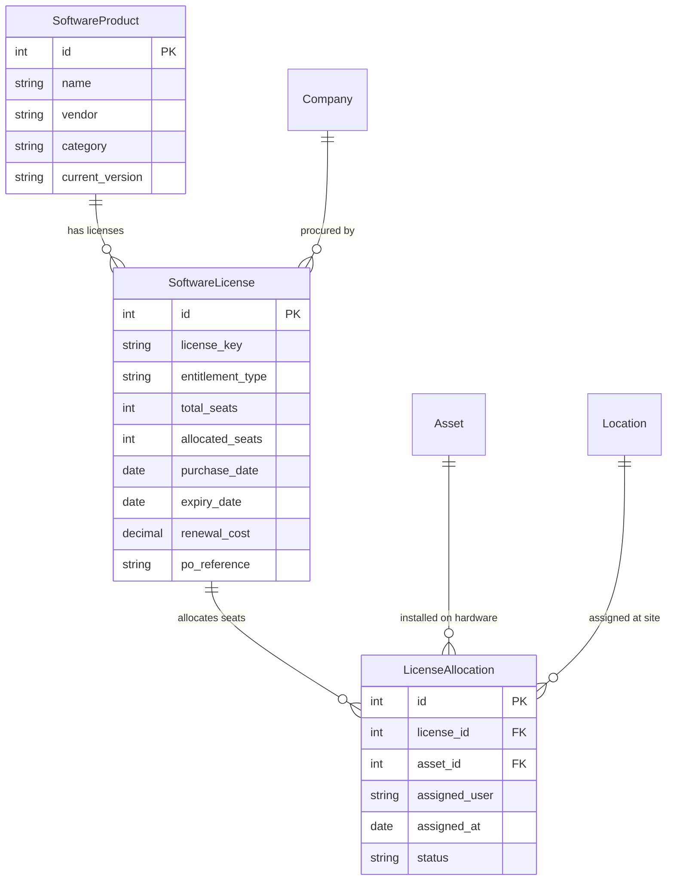

# Software & License Management (SLM) Module Specification
**Enterprise IT Asset Audit & Multi-Location Inventory System**  
**Organization:** Akij Group (Plastics, Motors, Jute, Ceramics, Food & Beverage, Corporate)  
**Document Type:** Functional & Technical Module Specification  
**Version:** 1.0 | **Status:** Approved Module Architecture  

---

## ১. মডিউল পরিচিতি ও লক্ষ্য (Executive Overview & Business Objectives)

আধুনিক এন্টারপ্রাইজ আইটি ব্যবস্থাপনায় শুধুমাত্র হার্ডওয়্যার (ফিজিক্যাল অ্যাসেট) ট্র্যাক করাই যথেষ্ট নয়। আকিজ গ্রুপের বিভিন্ন সিস্টার কনসার্ন, প্রধান কার্যালয়, কারখানা এবং দেশব্যাপী বিস্তৃত ডিপোগুলোতে বিপুল পরিমাণ **অপারেটিং সিস্টেম লাইসেন্স, এন্টারপ্রাইজ ইআরপি (ERP) ইউজার সিট, ক্লাউড সার্ভার/ভিএম (VM), অফিস স্যুট, সিকিউরিটি সফটওয়্যার এবং SSL/TLS সার্টিফিকেট** ব্যবহৃত হয়। 

এই সফটওয়্যার ও ভার্চুয়াল রিসোর্সগুলোর সঠিক হিসাব না থাকলে বড় ধরনের আর্থিক অপচয় (Unused Subscriptions), আইনি ঝুঁকি (BSA Compliance / License Piracy Penalty), এবং নিরাপত্তাজনিত বিপর্যয় (Expired SSL / License Lockout) ঘটতে পারে।

**Software & License Management (SLM)** মডিউলটির মূল লক্ষ্য হলো:
1. **কেন্দ্রীয় লাইসেন্স রেজিস্ট্রি:** গ্রুপের সমস্ত সফটওয়্যার লাইসেন্স, প্রডাক্ট কী, ক্লাউড ইনস্ট্যান্স এবং সাবস্ক্রিপশন এক জায়গায় সংরক্ষণ ও ট্র্যাক করা।
2. **লাইসেন্স পুল ও সিট মনিটরিং (Seat Utilization):** কেনা মোট লাইসেন্সের কতটি ব্যবহৃত হচ্ছে এবং কতটি ফাঁকা রয়েছে তা রিয়েল-টাইমে প্রদর্শন।
3. **স্বয়ংক্রিয় মেয়াদোত্তীর্ণ সতর্কতা (Expiry Alerts):** SSL সার্টিফিকেট ও বার্ষিক রিনিউয়াল শেষ হওয়ার ৩০/১৫/৭ দিন পূর্বে স্বয়ংক্রিয় ইমেইল ও ড্যাশবোর্ড অ্যালার্ট।
4. **হার্ডওয়্যার ও হোস্ট ম্যাপিং:** কোন ফিজিক্যাল ল্যাপটপ, সার্ভার বা ইউজারের সাথে কোন লাইসেন্স বা ক্লাউড ভিএম যুক্ত রয়েছে তা স্বচ্ছ রাখা।
5. **স্ট্যান্ডার্ড অ্যাসেট ট্যাগিং:** এন্টারপ্রাইজ স্ট্যান্ডার্ড মেনে লাইসেন্স ও লজিক্যাল অ্যাসেটকে স্বয়ংক্রিয় ট্যাগ প্রদান (যেমন: `APL-LIC-10001`, `APL-VM-10001`, `APL-SSL-10001`)।

---

## ২. সিস্টেম আর্কিটেকচার ও মডিউল পজিশনিং (Architecture & Positioning)

```
┌──────────────────────────────────────────────────────────────────────────────────┐
│              Enterprise IT Asset Audit & Inventory Web Portal                    │
├───────────────────────┬──────────────────────────────────┬───────────────────────┤
│  Physical Hardware    │  Software & License Management   │  Multi-Location Audit │
│  (Laptops, Desktops,  │  (OS, ERP, SaaS, Cloud VMs,      │  (Head Office, Depot, │
│   Routers, Switches)  │   SSL Certificates, Subscriptions)│   Factories, Stores)  │
└───────────┬───────────┴─────────────────┬────────────────┴───────────┬───────────┘
            │                             │                            │
            ▼                             ▼                            ▼
┌──────────────────────────────────────────────────────────────────────────────────┐
│                   Unified Django ORM & Relational Database                       │
│  - Asset Nature: PHYSICAL vs. LOGICAL                                            │
│  - Global Unique Asset Tagging: COMPANY - CATEGORY - SERIAL (e.g. APL-LIC-10001) │
│  - Location & Custody Tracking: Location ID, Department, Assigned User           │
└──────────────────────────────────────────────────────────────────────────────────┘
```

---

## ৩. সফটওয়্যার ও লজিক্যাল অ্যাসেটের শ্রেণিবিভাগ (Asset Classification)

সিস্টেমে ব্যবহৃত সফটওয়্যার ও লজিক্যাল অ্যাসেটসমূহকে নিম্নোক্ত প্রধান ৬টি শ্রেণিতে বিভক্ত করা হয়েছে:

| # | শ্রেণি (Category) | ক্যাটাগরি কোড | উদাহরণ ও ব্র্যান্ড (Examples & Vendors) | লাইসেন্সিং মডেল (Model) |
|---|-------------------|:-------------:|----------------------------------------|-------------------------|
| 1 | **Operating System (OS)** | `LIC` / `OS` | Windows Server 2022 Datacenter, Windows 11 Enterprise, Red Hat Enterprise Linux (RHEL) | Per Core / Per Machine / OEM |
| 2 | **Productivity & Office SaaS** | `LIC` / `OFF` | Microsoft 365 (E3/E5/Business Basic), Google Workspace, Adobe Creative Cloud | Per User / Monthly or Annual SaaS |
| 3 | **Enterprise Core ERP & DB** | `ERP` / `DB` | SAP S/4HANA Named User, Oracle Database Enterprise, Tally Prime, In-house ERP | Per User Seat / Named License / Processor License |
| 4 | **Cloud Infrastructure & VMs** | `VM` / `CLD` | AWS EC2 (t3.xlarge, m5.large), Azure Virtual Machines, Google Cloud Compute, Proxmox VM | On-demand / Reserved Instance (RI) |
| 5 | **Security & Infrastructure** | `SEC` / `FWL` | Kaspersky Endpoint Security, CrowdStrike Falcon, FortiClient VPN, Veeam Backup | Per Endpoint / Node Subscription |
| 6 | **SSL, Domain & Network** | `SSL` / `DOM` | DigiCert Wildcard SSL (*.akij.net), GoDaddy Domain Registration, Public IP / VLAN Blocks | Annual / Multi-year Renewal |

---

## ৪. লাইসেন্সিং মডেল ও এনটাইটেলমেন্ট (Licensing & Entitlement Schemes)

এই মডিউলটি নিচের ৪টি আন্তর্জাতিক এন্টারপ্রাইজ লাইসেন্সিং পদ্ধতি সাপোর্ট করে:

1. **Per-Seat / Volume License (ভলিউম লাইসেন্স):**
   - একটি মাস্টার লাইসেন্স কি (Master Key) দিয়ে একাধিক ডিভাইসে অ্যাক্টিভেশন (যেমন: Windows 11 Pro Enterprise MAK/KMS - ১০০ সিট)।
   - সিস্টেম স্বয়ংক্রিয়ভাবে হিসাব রাখবে: $\text{Available Seats} = \text{Total Purchased} - \text{Assigned Seats}$।

2. **Named User / Per-User Subscription (ব্যক্তিগত সাবস্ক্রিপশন):**
   - নির্দিষ্ট কর্মকর্তার কর্পোরেট ইমেইলের সাথে যুক্ত (যেমন: `aminur.rahman@akij.net`-এর জন্য Microsoft 365 E5 ও SAP ERP User)।

3. **Per-Core / Server Socket (সার্ভার কোর লাইসেন্স):**
   - ফিজিক্যাল সার্ভারের প্রসেসর কোরের সংখ্যার ওপর নির্ভরশীল (যেমন: Windows Server Datacenter - ১৬ কোর বা ৩২ কোর প্যাকেজ)।

4. **Periodic Renewal / Certificate (মেয়াদী নবায়নযোগ্য অ্যাসেট):**
   - ফিক্সড মেয়াদের জন্য কেনা (যেমন: ১ বছর বা ২ বছর মেয়াদী SSL/TLS সার্টিফিকেট ও ডোমেন রেজিস্ট্রেশন)।

---

## ৫. ডাটাবেজ মডেল ডিজাইন (Database & Data Model Architecture)

সিস্টেমের বর্তমান আর্কিটেকচার অনুযায়ী `Asset` মডেলের সাথে সমন্বিত এবং ভবিষ্যতে ডেডিকেটেড এক্সটেন্ডেড মডেলের স্কিমা নিচে উপস্থাপন করা হলো:

### ৫.১ সমন্বিত অ্যাসেট স্কিমা (Current Implementation in `Asset`)
```python
class Asset(TimeStampedModel):
    NATURE_CHOICES = (
        ('PHYSICAL', 'Physical (Hardware)'),
        ('LOGICAL', 'Logical / Virtual (Software/License/Cloud)'),
    )
    asset_nature = models.CharField(max_length=20, choices=NATURE_CHOICES, default='PHYSICAL', db_index=True)
    asset_tag = models.CharField(max_length=50, unique=True, db_index=True) # e.g. APL-LIC-10001
    device_type = models.ForeignKey(DeviceType, on_delete=models.CASCADE)
    location = models.ForeignKey(Location, on_delete=models.CASCADE)
    
    # Logical & Virtual Specific Attributes
    vendor = models.CharField(max_length=150, blank=True, null=True, verbose_name="Software Publisher / Vendor")
    version = models.CharField(max_length=120, blank=True, null=True, verbose_name="Edition / Version / Tier")
    license_key = models.CharField(max_length=255, blank=True, null=True, verbose_name="License Key / Subscription ID")
    host_server = models.CharField(max_length=150, blank=True, null=True, verbose_name="Host Server / Cloud Cluster")
    
    # Financial & Validity
    purchase_date = models.DateField(null=True, blank=True, verbose_name="Procurement / Activation Date")
    warranty_expiry = models.DateField(null=True, blank=True, verbose_name="License Renewal / Expiry Date")
    purchase_cost = models.DecimalField(max_digits=12, decimal_places=2, null=True, blank=True)
    currency = models.CharField(max_length=10, default="BDT")
```

### ৫.২ এক্সটেন্ডেড লাইসেন্স পুলিং মডেল (Full SLM Dedicated Architecture)

উন্নত লাইসেন্স পুল ও সিট ম্যানেজমেন্টের জন্য পরবর্তী ফেজে নিচের রিলেশনাল মডেলসমূহ ব্যবহৃত হবে:



---

## ৬. ইউজার ইন্টারফেস ও ফিচার ম্যাপ (UI/UX & Core Features)

### ৬.১ সফটওয়্যার ও লাইসেন্স ড্যাশবোর্ড (`/software/` বা `/assets/?nature=LOGICAL`)
- **KPI কার্ডস:**
  1. *Total Active Licenses / Subscriptions*
  2. *Expiring Within 30 Days (Warning)*
  3. *Unassigned / Available Seats (Cost Optimization)*
  4. *Projected Annual Renewal Budget (BDT)*
- **লাইসেন্সিং পাই চার্ট:** ভেন্ডরভিত্তিক বিভাজন (Microsoft vs. Oracle vs. AWS vs. Others)।
- **স্ট্যাটাস ইন্ডিকেটর:**
  - <span style="color:green;font-weight:bold;">Active &amp; Compliant</span> (সবুজ)
  - <span style="color:orange;font-weight:bold;">Expiring Soon (&lt; 30 Days)</span> (কমলা)
  - <span style="color:red;font-weight:bold;">Expired / Over-allocated</span> (লাল)

### ৬.২ লাইসেন্স অ্যাসাইনমেন্ট ও সিট অ্যালোকেশন (Seat Allocation Workflow)
- যেকোনো লাইসেন্স এক ক্লিকে নির্দিষ্ট ল্যাপটপ, সার্ভার বা ইউজারের সাথে ট্যাগ করা যাবে।
- ডিভাইস স্ক্র্যাপ বা ইউজার কোম্পানি ছাড়লে স্বয়ংক্রিয়ভাবে লাইসেন্স ডি-অ্যালোকেট হয়ে পুলে ফেরত আসবে।

### ৬.৩ মেয়াদের ক্যালেন্ডার ও নোটিফিকেশন ইঞ্জিন
- **ইমেইল নোটিফিকেশন ট্রিগার:**
  - ৬০ দিন আগে: প্রারম্ভিক বাজেট প্ল্যানিং অ্যালার্ট
  - ৩০ দিন আগে: ভেন্ডর কোটেশন ও রিনিউয়াল রিমাইন্ডার
  - ৭ দিন আগে: উচ্চ অগ্রাধিকার ক্রাইসিস ওয়ার্নিং
- **ড্যাশবোর্ড ড্রপডাউন অ্যালার্ট:** লগইন করার সাথে সাথে উপরের নোটিফিকেশন বেল আইকনে মেয়াদের তালিকা প্রদর্শন।

---

## ৭. স্প্রেডশিট ও সিএসভি বাল্ক অপারেশন (CSV Import & Export)

গ্রুপের শত শত লাইসেন্স মুহূর্তেই সিস্টেমে আপলোড করার জন্য বিশেষ সিএসভি ফরম্যাট প্রণয়ন করা হয়েছে:

### ৭.১ অনুমোদিত কলাম হেডার (Accepted CSV Headers)
```csv
asset_tag,device_type,location_code_or_id,vendor,version,license_key,host_server,department,assigned_user,status,purchase_date,warranty_expiry,remarks
```

### ৭.২ নমুনা ডেটা (Sample Data Row)
```csv
APL-LIC-10001,Software License (OS / Office),LOC-001,Microsoft Corporation,Windows 11 Pro Enterprise,W269N-WFGWX-YVC9B-4J6C9-T83GX,Client Laptops,Accounts & Finance,Md. Aminur Rahman,IN_USE,2024-01-01,2027-12-31,Akij Group Enterprise Agreement
APL-ERP-10002,Enterprise ERP User License,LOC-002,Oracle Corporation,Production Core v12,ORCL-ERP-AKIJ-9981,Cloud Cluster,Supply Chain,Factory GM,IN_USE,2023-06-15,2025-06-14,Dedicated Named User License
APL-VM-10003,Cloud Virtual Server / VM,LOC-001,Amazon Web Services,Ubuntu 22.04 LTS (t3.xlarge),i-0ab4c12d34ef56789,AWS ap-south-1,IT Infrastructure,DevOps Team,IN_USE,2023-03-01,,Production DB Cluster Node
APL-SSL-10004,SSL / TLS Certificate,LOC-001,DigiCert Inc.,Wildcard SSL (*.akij.net),CERT-DC-2024-8871,HAProxy Cluster,IT Infrastructure,Network Security,IN_USE,2024-02-10,2025-02-09,Corporate Portal SSL
```

---

## ৮. অডিট কমপ্লায়েন্স ও আইনি নিরাপত্তা (Audit Compliance & Governance)

1. **বিএসএ (BSA) অডিট প্রস্তুতি:**
   - যেকোনো আন্তর্জাতিক অডিটে এক ক্লিকে সমস্ত কেনা লাইসেন্সের ইনভয়েস নম্বর, পিও (PO) রেফারেন্স এবং সক্রিয় ইনস্টলেশন রিপোর্ট এক্সপোর্ট করা যাবে।
2. **ওভার-লাইসেন্সিং বা অতিরিক্ত সিট বরাদ্দ রোধ:**
   - কেনা লাইসেন্সের চেয়ে বেশি ইনস্টল করার চেষ্টা করলে সিস্টেম ওয়ার্নিং দেবে।
3. **অননুমোদিত বা ক্র্যাকড সফটওয়্যার শূন্যের কোঠায় নামানো:**
   - অডিট অফিসার ফিজিক্যাল সাইট ভিজিটের সময় পিসির সফটওয়্যার তালিকার সাথে কেন্দ্রীয় ডাটাবেসের সিরিয়াল/লাইসেন্স কী মিলিয়ে ভেরিফাই করতে পারবেন।

---

## ৯. বাস্তবায়নের রোডম্যাপ (Implementation Roadmap)

| ধাপ (Phase) | কাজের পরিধি ও ফিচারসমূহ | অবস্থা (Status) |
|---|------------------------|:---------------:|
| **Phase 1** | `asset_nature='LOGICAL'` সাপোর্ট, ডাটাবেজ ফিল্ডস (`vendor`, `version`, `license_key`, `host_server`), ডাইনামিক ফিল্টারিং এবং সিএসভি বাল্ক আপলোড ও টেমপ্লেট ডাউনলোড। | **সম্পন্ন (Active in Production)** |
| **Phase 2** | কোম্পানি ও ক্যাটাগরি অনুযায়ী স্ট্যান্ডার্ড ট্যাগ জেনারেশন (`APL-LIC-10001`, `APL-VM-10001`), রিনিউয়াল এক্সপায়ারি অ্যালার্ট এবং ড্যাশবোর্ড লজিক্যাল মেট্রিক্স। | **সম্পন্ন (Active in Production)** |
| **Phase 3** | ডেডিকেটেড সিট পুলিং টেবিল (`SoftwareLicense` & `LicenseAllocation`), ভেন্ডর কন্ট্রাক্ট এটাচমেন্ট (PDF PO Upload), এবং অটোমেটেড অডিট রিকনসিলিয়েশন। | **পরবর্তী ভার্সন (Next Release)** |

---

## ১০. সংক্ষেপ ও কনক্লুশন (Summary)

এই স্পেসিফিকেশন ডকুমেন্টটি আকিজ গ্রুপের সকল সফটওয়্যার, সাবস্ক্রিপশন ও ভার্চুয়াল রিসোর্সকে হার্ডওয়্যারের মতোই সমান গুরুত্ব ও নিয়মানুবর্তিতার আওতায় নিয়ে এসেছে। এর ফলে গ্রুপের আইটি ইনফ্রাস্ট্রাকচার যেমন শতভাগ নিরাপদ ও অডিট-কমপ্লায়েন্ট থাকবে, তেমনি অপ্রয়োজনীয় লাইসেন্স রিনিউয়ালের হাজার হাজার টাকা সাশ্রয় হবে।
